

  

  

  

  

  <a href="https://github.com/yashas004/Persona.AI"></a>

  <a href="https://github.com/yashas004/PriorAuth"></a>

  <a href="https://github.com/yashas004/SecureWays"></a>

  <a href="https://github.com/yashas004/Finways"></a>

  

  <picture>
    <source srcset="https://raw.githubusercontent.com/yashas004/yashas004/output/snake-dark.svg" media="(prefers-color-scheme: dark)">
    
  </picture>

  <a href="mailto:yashasyadav04@gmail.com"></a>
  <a href="https://www.youtube.com/@yashasyadav04"></a>

  

