  

  

  

  

  

  

  

  

  

  

  

  

  

  

  

  <picture>
    <source srcset="https://raw.githubusercontent.com/yashas004/yashas004/output/snake-dark.svg" media="(prefers-color-scheme: dark)">
    
  </picture>

  

  
  

  

